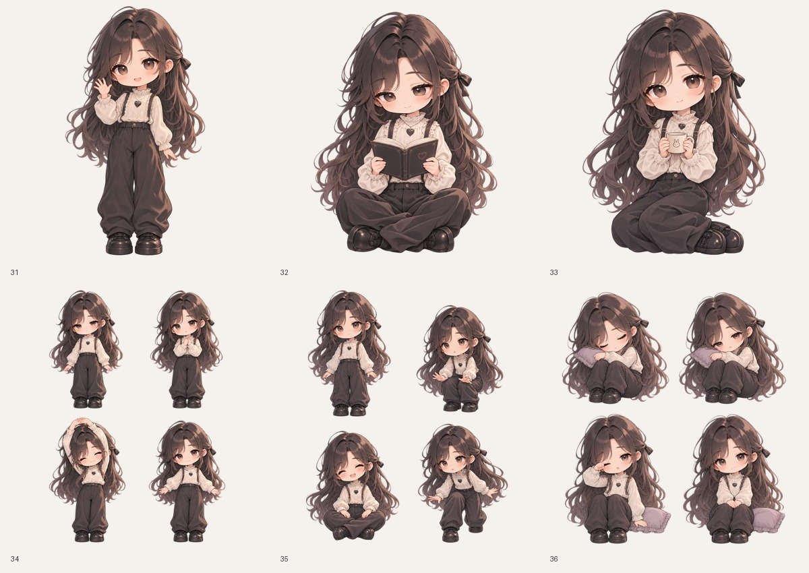

# 小五 A-01 · 第二批原画与已通过动画

6 张透明 PNG 原画，生成于 2026-11-15。2026-11-16 用户批准 B「看书眨眼」；A「温柔挥手」和 C「捧杯轻抬」因形变影响背景、未形成完整动作而未通过，不上传其样片。

- [31_温柔挥手](原画/31_温柔挥手.png)
- [32_安静看书](原画/32_安静看书.png)
- [33_捧杯喝茶](原画/33_捧杯喝茶.png)
- [34_伸懒腰_四关键帧](原画/34_伸懒腰_四关键帧.png)
- [35_坐下起身_四关键帧](原画/35_坐下起身_四关键帧.png)
- [36_睡觉醒来_四关键帧](原画/36_睡觉醒来_四关键帧.png)

## 已通过：B 看书眨眼

[MP4 版本](GIF已通过/B_看书眨眼_已通过.mp4)。512×512，5 秒循环，25 帧/秒，米白背景，无透明通道。由 AI 闭眼关键帧、局部光流补间和微幅呼吸制作；尚未接入桌宠运行时。

原画板需切帧、对齐及动作调整，不能直接视为完整动画。校验见 [原画校验.json](原画校验.json)，审批见 [审批记录.json](审批记录.json)。提示词中的参考图路径指向本地第一批素材。
