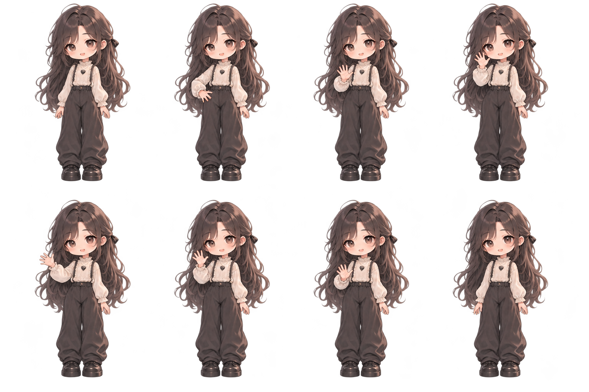
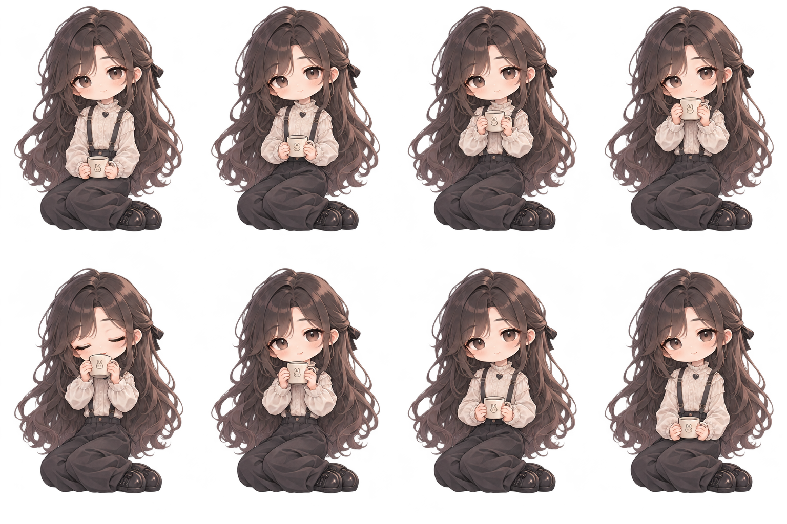

# 小五 A-01 · 2026-11-17 动作返工原画

针对旧 A/C 样片的背景形变与动作不完整问题，重新生成两张 4×2 透明原画板，共 16 个完整人物姿态。

## 37 挥手完整动作

抬臂 → 胸前 → 脸侧 → 外摆 → 回摆 → 放下。

## 38 捧杯喝茶完整动作

膝上捧杯 → 抬杯 → 碰唇 → 饮用 → 放回。

两张均为 1536×1024 RGBA，保留生成的真实透明通道。使用内置 image_gen 生成，提示词见 [提示词.json](提示词.json)，SHA-256 见 [原画校验.json](原画校验.json)。

本地新样片 A2/C2 采用八姿态切帧与停顿编排，只做统一比例及平移对齐，不使用光流或局部形变。它们属于有限帧动作预览，仍需用户审批，未上传 GIF/MP4，也未接入桌宠。此前通过的 B 动画保持不变。
